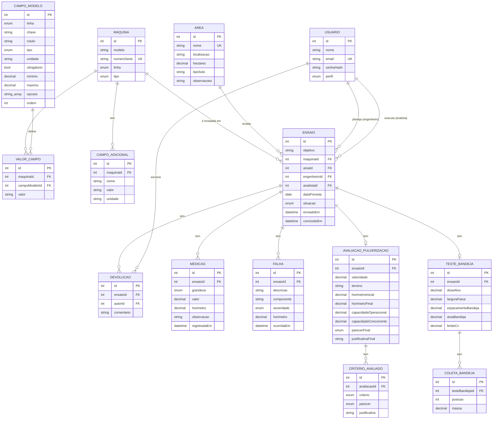
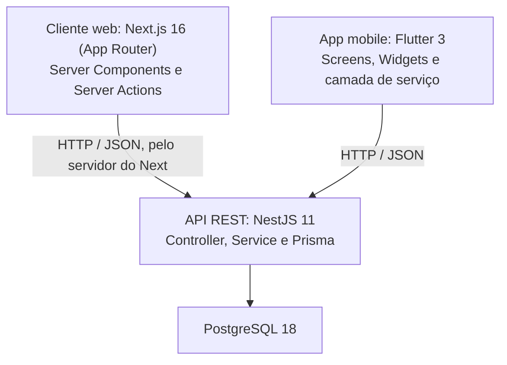

# PRD: Product Requirements Document

O contrato da API vive em documento separado: [`docs/contrato-api.md`](contrato-api.md). Este PRD define o que o sistema faz; o contrato define como os clientes conversam com ele.

---

## Identificação

| Campo | Valor |
|---|---|
| Nome do projeto | Campo Conectado |
| Grupo | Trabalho individual, autorizado pelo professor por e-mail em 03/10/2026 |
| Versão do documento | 1.2 |
| Data de criação | 19/11/2026 |
| Última atualização | 26/11/2026 |
| Documento de Visão (ref.) | `docs/visao.md` |
| Contrato da API (ref.) | `docs/contrato-api.md` |

---

## 1. Objetivo do produto

O Campo Conectado organiza os ensaios de campo de máquinas agrícolas. O engenheiro planeja o ensaio e o atribui a um analista no cliente web; o analista registra medições, falhas e a avaliação no campo, pelo celular; a API calcula as evidências e barra avaliações incoerentes; o engenheiro revisa, devolve ou conclui. Resolve o registro em papel, redigitado depois e sem conferência técnica.

---

## 2. Personas

### Persona 1: Eduarda, engenheira de produto

- Contexto: responde pela validação de pulverizadores e distribuidores; passa o dia no escritório, com dois monitores.
- Cliente principal: web
- Objetivo principal no sistema: planejar os ensaios da semana e decidir, com evidência, se cada máquina está aprovada.
- Maior frustração atual (sem o sistema): receber planilhas incompletas dias depois do ensaio e descobrir incoerências (máquina "aprovada" com falha crítica) só na hora de assinar.
- Critério de sucesso: abrir um ensaio enviado e ter medições, falhas, evidências e pareceres numa tela, com a certeza de que as regras já foram conferidas.

### Persona 2: Artur, analista de validação

- Contexto: acompanha as máquinas na área de ensaio, ao lado do operador, com o celular no bolso e sinal de rede irregular.
- Cliente principal: mobile
- Objetivo principal no sistema: registrar cada medição e falha no momento em que acontece e enviar o ensaio sem precisar voltar ao escritório.
- Maior frustração atual (sem o sistema): anotar em papel, redigitar à noite e ter o ensaio devolvido por um campo esquecido.
- Critério de sucesso: ver no app o que falta para enviar e enviar na primeira tentativa.

---

## 3. Requisitos funcionais

### 3.1 Autenticação e sessão

| ID | Descrição | Prioridade | Persona | Cliente |
|---|---|---|---|---|
| RF-001 | O usuário entra no sistema informando e-mail e senha e recebe acesso às funcionalidades do seu perfil | Alta | todas | web / mobile |
| RF-002 | O usuário encerra a sessão e deixa de ter acesso às rotas protegidas | Alta | todas | web / mobile |
| RF-003 | Os usuários são criados pelo seed do banco; não há auto-cadastro nem recuperação de senha | Alta | todas | nenhum |
| RF-004 | Cada cliente aceita só o seu perfil: o web recusa o analista e o app recusa o engenheiro, com mensagem que indica o cliente certo | Média | todas | web / mobile |

### 3.2 Áreas de ensaio

| ID | Descrição | Prioridade | Persona | Cliente |
|---|---|---|---|---|
| RF-010 | O engenheiro lista as áreas, com busca pelo nome e paginação | Alta | Eduarda | web |
| RF-011 | O engenheiro cadastra e edita uma área (nome, localização, hectares, tipo de solo, observações) | Alta | Eduarda | web |
| RF-012 | O engenheiro remove uma área que não tenha ensaios | Média | Eduarda | web |

### 3.3 Máquinas e ficha

| ID | Descrição | Prioridade | Persona | Cliente |
|---|---|---|---|---|
| RF-020 | Ao escolher a linha da máquina, o sistema apresenta os tipos aceitos e os campos da ficha daquela linha | Alta | Eduarda | web |
| RF-021 | O engenheiro cadastra uma máquina (modelo, número de série, linha, tipo e ficha), com a ficha validada pela API | Alta | Eduarda | web |
| RF-022 | O engenheiro acrescenta até 20 campos adicionais (nome, valor, unidade) à ficha | Média | Eduarda | web |
| RF-023 | O engenheiro lista as máquinas, com filtro por linha, busca por modelo ou número de série e paginação | Alta | Eduarda | web |
| RF-024 | O engenheiro edita a máquina; a troca de linha exige a ficha completa da nova linha | Alta | Eduarda | web |
| RF-025 | O engenheiro remove uma máquina que não tenha ensaios | Média | Eduarda | web |

### 3.4 Planejamento de ensaios (CU-W1)

| ID | Descrição | Prioridade | Persona | Cliente |
|---|---|---|---|---|
| RF-030 | O engenheiro planeja um ensaio (objetivo, máquina, área, data prevista) e o atribui a um analista | Alta | Eduarda | web |
| RF-031 | O sistema lista os analistas para a atribuição | Alta | Eduarda | web |
| RF-032 | O engenheiro lista todos os ensaios, com filtro por situação e paginação | Alta | Eduarda | web |
| RF-033 | O engenheiro altera ou remove um ensaio enquanto ele está planejado | Média | Eduarda | web |

### 3.5 Registro em campo (CU-M1 e CU-M2)

| ID | Descrição | Prioridade | Persona | Cliente |
|---|---|---|---|---|
| RF-040 | O analista vê a lista dos ensaios atribuídos a ele, com a situação de cada um | Alta | Artur | mobile |
| RF-041 | O analista registra uma medição (grandeza, valor, horímetro, observação); o primeiro registro inicia o ensaio | Alta | Artur | mobile |
| RF-042 | O analista registra uma falha (descrição, componente, severidade, horímetro) | Alta | Artur | mobile |
| RF-043 | O analista remove um registro lançado por engano, enquanto o ensaio aceita registros | Média | Artur | mobile |
| RF-044 | Na Pulverização, o analista preenche as condições do ensaio (velocidade, terreno, horímetros, capacidade própria e da concorrente) | Alta | Artur | mobile |
| RF-045 | Na Pulverização, o analista dá o parecer de cada critério, salvando um por vez | Alta | Artur | mobile |
| RF-046 | Na Pulverização, o analista registra o parecer final | Alta | Artur | mobile |
| RF-047 | O analista vê o progresso da avaliação e a lista do que falta para enviar | Média | Artur | mobile |
| RF-048 | O analista envia o ensaio ao engenheiro | Alta | Artur | mobile |

### 3.6 Revisão e decisão (CU-W2)

| ID | Descrição | Prioridade | Persona | Cliente |
|---|---|---|---|---|
| RF-050 | O engenheiro revisa o ensaio: medições, falhas, avaliação e as evidências calculadas pela API | Alta | Eduarda | web |
| RF-051 | O engenheiro devolve o ensaio enviado com um comentário do que corrigir | Alta | Eduarda | web |
| RF-052 | O engenheiro conclui o ensaio enviado | Alta | Eduarda | web |
| RF-053 | O histórico de devoluções fica visível no ensaio, nos dois clientes | Média | todas | web / mobile |

### 3.7 Teste de bandeja (Distribuição)

| ID | Descrição | Prioridade | Persona | Cliente |
|---|---|---|---|---|
| RF-060 | O analista registra o teste de bandeja e a API calcula dose média, desvio, CV e diferença para a dose alvo | Média | Artur | mobile |
| RF-061 | A API simula a faixa efetiva por sobreposição das passadas | Baixa | Eduarda | web |

RF-060 e RF-061 estão modelados no banco (`TesteBandeja`, `ColetaBandeja`), mas não foram implementados nesta versão.

---

## 4. Requisitos não funcionais

| ID | Categoria | Descrição | Critério de aceitação |
|---|---|---|---|
| RNF-001 | Segurança: credenciais | Senhas são armazenadas com hash e nunca em texto puro | A coluna `senhaHash` guarda hash bcrypt (custo 10); nenhuma resposta da API devolve o hash |
| RNF-002 | Segurança: sessão | O acesso é feito por token JWT, com validade de 1 hora | Token expirado é recusado com `401` |
| RNF-003 | Segurança: rotas | Toda rota que não seja pública exige token válido | Sem token: `401`; perfil insuficiente: `403`. Públicas só `GET /saude` e `POST /auth/login` |
| RNF-004 | Segurança: segredos | Chaves e credenciais ficam em variável de ambiente | `.env` fora do Git; só `.env.example` versionado; nenhum segredo no app |
| RNF-005 | Desempenho | Listagens paginadas, com no máximo 100 itens por página | `tamanho` acima de 100 recusado com `400`; o padrão é 20 |
| RNF-006 | Usabilidade | Interfaces em português, com erro junto do campo e números com vírgula | Mensagens da API em pt-BR; formulários do web mantêm o que foi digitado após um erro |
| RNF-007 | Manutenibilidade | Regras de negócio testadas e erro em formato único | Testes unitários e e2e do backend passando; lint e build sem erro nos três projetos |
| RNF-008 | Comportamento em rede instável (mobile) | O app informa a falha de rede sem travar | Tempo limite de 10 s; mensagens distintas para sem conexão e tempo esgotado |
| RNF-009 | Integridade de estado | Mudanças de situação concorrentes não corrompem o ensaio | A transição só grava se a situação lida ainda for a atual; senão `409` |
| RNF-010 | Segurança: erros | Erros internos não vazam detalhes do banco | Erro 5xx devolve só "Erro interno do servidor"; erros do Prisma são traduzidos |

---

## 5. Regras de negócio

| ID | Regra | Validação antecipada no cliente? |
|---|---|---|
| RN-001 | A linha define os tipos aceitos: Distribuição (arrasto ou autopropelido), Pulverização (autopropelido), Plantio (arrasto ou montada) | sim (web: só mostra os tipos da linha) |
| RN-002 | A ficha é validada contra os campos da linha: tipo, faixa, obrigatoriedade e opções; chave desconhecida é recusada | sim (web) |
| RN-003 | A máquina só troca de linha se não tiver ensaios, e a troca exige a ficha completa da nova linha | não |
| RN-004 | Número de série de máquina e nome de área são únicos | não |
| RN-005 | Máquina ou área com ensaios não pode ser removida | não |
| RN-006 | Ciclo do ensaio: PLANEJADO → EM_ANDAMENTO → ENVIADO → CONCLUIDO, com ENVIADO → DEVOLVIDO → ENVIADO | sim (botões só aparecem na situação certa) |
| RN-007 | O planejamento só é alterado ou removido enquanto o ensaio está PLANEJADO | sim (web) |
| RN-008 | Medições e falhas só são aceitas com o ensaio PLANEJADO, EM_ANDAMENTO ou DEVOLVIDO; o primeiro registro inicia o ensaio | sim (app) |
| RN-009 | A data e hora de um registro não pode estar no futuro (tolerância de 5 minutos) | não |
| RN-010 | Parecer de critério diferente de "Conforme" e parecer final diferente de "Aprovada" exigem justificativa | sim (app) |
| RN-011 | O horímetro final não pode ser menor que o inicial | sim (app) |
| RN-012 | Com falha crítica registrada, a durabilidade das peças não pode ser "Conforme" | não |
| RN-013 | Com falha crítica ou algum critério "Não conforme", o parecer final não pode ser "Aprovada" | não |
| RN-014 | Para enviar: ao menos uma medição de cada grandeza e, na Pulverização, avaliação completa e coerente (RN-010 a RN-013) | sim (app mostra as pendências da API) |
| RN-015 | Para concluir: as mesmas exigências de RN-014, conferidas de novo | sim (web mostra as pendências da API) |
| RN-016 | A devolução exige um comentário | sim (web) |
| RN-017 | As evidências (temperatura máxima contra o limite da ficha, falhas por severidade, horas trabalhadas e diferença percentual para a concorrente) são calculadas só pela API | não: os clientes só exibem |

Autorização: quem pode o quê. A tabela completa está em `docs/contrato-api.md`, seção 2.3. Regras que não são óbvias a partir dos perfis:

| ID | Regra de autorização | Perfil |
|---|---|---|
| RN-A01 | O analista só vê, registra e envia nos ensaios atribuídos a ele; nos dos outros recebe `403` | ANALISTA |
| RN-A02 | Cadastros, planejamento, devolução e conclusão são só do engenheiro | ENGENHEIRO |
| RN-A03 | Registrar, avaliar e enviar são só do analista do ensaio; o engenheiro consulta, mas não registra | ANALISTA |

---

## 6. Modelo de dados

### 6.1 Diagrama ER

Todas as entidades têm `criadoEm` e as editáveis têm `atualizadoEm` (omitidos no diagrama). O diagrama corresponde a `backend/prisma/schema.prisma`.

### 6.2 Descrição das entidades

| Entidade | Responsabilidade | Principais atributos |
|---|---|---|
| Usuario | Quem acessa o sistema | nome, email (único), senhaHash, perfil (ENGENHEIRO, ANALISTA) |
| Area | Local onde o ensaio acontece | nome (único), localizacao, hectares, tipoSolo |
| Maquina | Máquina em validação | modelo, numeroSerie (único), linha, tipo |
| CampoModelo | Campo pré-definido da ficha de uma linha (seed) | linha, chave, rotulo, tipo, unidade, obrigatorio, minimo, maximo, opcoes |
| ValorCampo | Valor de um campo da ficha numa máquina, guardado como texto | maquinaId, campoModeloId, valor |
| CampoAdicional | Dado livre acrescentado à ficha | nome (único por máquina), valor, unidade |
| Ensaio | Teste planejado e atribuído; centro do domínio | objetivo, dataPrevista, situacao, enviadoEm, concluidoEm |
| Devolucao | Histórico de devoluções com o comentário | comentario, autorId |
| Medicao | Valor medido de uma grandeza | grandeza, valor, horimetro, registradaEm |
| Falha | Ocorrência durante o ensaio | descricao, componente, severidade |
| AvaliacaoPulverizacao | Condições e parecer final do ensaio de Pulverização | velocidade, terreno, horímetros, capacidades, parecerFinal |
| CriterioAvaliado | Parecer de um critério da avaliação | criterio, parecer, justificativa |
| TesteBandeja / ColetaBandeja | Teste de bandeja da Distribuição (não implementado nesta versão) | doseAlvo, larguraFaixa, posicao, massa |

---

## 7. Recorte web/mobile

| Funcionalidade | Web | Mobile | Justificativa |
|---|---|---|---|
| Cadastro de áreas e máquinas com ficha | ✅ | - | Fichas longas e dados de referência: tarefa de escritório, com teclado e tela grande |
| Planejar e atribuir ensaio | ✅ | - | Decisão do engenheiro, que cruza máquinas, áreas e analistas |
| Ver meus ensaios | - | ✅ | O analista precisa saber, no campo, o que tem para fazer |
| Registrar medição e falha | - | ✅ | Acontece ao lado da máquina, no momento da medição |
| Avaliação da Pulverização e envio | - | ✅ | Preenchida aos poucos durante o ensaio, com um único botão para salvar |
| Revisar, devolver e concluir | ✅ | - | Exige ver tudo de uma vez e decidir com calma |
| Consultar o ensaio e as devoluções | ✅ | ✅ | O engenheiro acompanha; o analista lê o que corrigir |
| Login e saída | ✅ | ✅ | Cada cliente com o seu perfil |

O que ficou de fora do mobile e por quê: cadastros, planejamento e decisão. São tarefas do engenheiro, feitas no escritório; no celular seriam lentas e não acontecem no campo.

O que ficou de fora do web e por quê: registrar medições, falhas e a avaliação. O dado nasce no campo; digitá-lo depois no computador é exatamente o retrabalho que o sistema elimina. O engenheiro vê esses registros, mas não os altera.

Recorte mobile mínimo (1 a 3 casos de uso, com leitura e escrita na API):
- CU-M1, ver meus ensaios: lista dos ensaios atribuídos ao analista, com o detalhe, os registros e o comentário de devolução (leitura).
- CU-M2, registrar dados do ensaio: medições, falhas, avaliação da Pulverização e envio ao engenheiro (escrita).

---

## 8. Arquitetura da solução

### 8.1 Visão geral dos componentes

### 8.2 Estrutura dos três projetos

| Componente | Desvio em relação ao README | Motivo |
|---|---|---|
| Backend | Configuração do Prisma em `prisma7.config.ts`; cliente gerado em `src/generated/prisma` (fora do Git); pasta `src/comum/` com filtro de erro, paginação e validadores | Padrão do Prisma 7 visto na Aula 7; código compartilhado entre módulos |
| Cliente web | Sem `src/types/`: os tipos ficam junto do acesso à API em `src/lib/<recurso>.ts`; Server Actions em `src/app/<recurso>/acoes.ts` | Padrão das aulas 13 a 15: tipo, leitura e escrita de um recurso no mesmo arquivo |
| App mobile | `formatos.dart` e `validacao.dart` na raiz de `lib/`; pasta `android/` gerada pelo `flutter create`; a pasta `ios/` não foi gerada nesta versão | Funções puras usadas por várias telas; o app é executado em Android |

### 8.3 Módulos e recursos do backend

| Módulo | Recurso do domínio | Endpoints previstos |
|---|---|---|
| saude | Situação da API e do banco | `GET /saude` |
| auth | Login e perfil | `POST /auth/login`, `GET /auth/perfil` |
| usuarios | Usuários (analistas para atribuição) | `GET /usuarios` |
| areas | Áreas de ensaio | `GET/POST /areas`, `GET/PATCH/DELETE /areas/:id` |
| maquinas | Máquinas e ficha | `GET /campos-modelo`, `GET/POST /maquinas`, `GET/PATCH/DELETE /maquinas/:id` |
| ensaios | Ensaios e ciclo de vida | `GET/POST /ensaios`, `GET/PATCH/DELETE /ensaios/:id`, `GET /ensaios/:id/pendencias`, `POST /ensaios/:id/iniciar`, `/enviar`, `/devolver`, `/concluir` |
| medicoes | Medições do ensaio | `GET/POST /ensaios/:ensaioId/medicoes`, `DELETE .../:id` |
| falhas | Falhas do ensaio | `GET/POST /ensaios/:ensaioId/falhas`, `DELETE .../:id` |
| avaliacao | Avaliação da Pulverização | `GET/PATCH /ensaios/:ensaioId/avaliacao`, `PUT .../criterios/:criterio` |

### 8.4 Decisões técnicas por componente

| Componente | Decisão a tomar | Escolha | Justificativa |
|---|---|---|---|
| Backend | Estratégia de autenticação | JWT simples (HS256, 1 hora), sem refresh | Suficiente para o escopo; guards globais com `@Public` e `@Roles` |
| Backend | Formato de identificador | Inteiro autoincremental | Simples de ler nas URLs e nos testes; o domínio não exige id distribuído |
| Web | Fronteira Server / Client Components | Páginas e leituras no servidor; Client Components só nos formulários (`useActionState`) e nos botões | Padrão das aulas; o token nunca vai para o navegador |
| Web | Estratégia de revalidação e cache | Leituras autenticadas com `cache: "no-store"`; sem `cacheComponents` | Dados de um usuário não entram em cache compartilhado; depois de gravar, a ação redireciona e a página relê |
| Mobile | Gerência de estado | `setState` nas telas e `ChangeNotifier` na sessão | Suficiente para o escopo, como nas aulas 17 e 18 |
| Mobile | Nível de autenticação e armazenamento do token | Simplificada: login real e token só em memória | Decisão do autor; em `401` o app volta ao login |

### 8.5 Tecnologias e versões

| Tecnologia | Versão | Papel |
|---|---|---|
| Node.js | 22 LTS | Runtime do backend e do web |
| NestJS | 11 | Framework da API |
| Prisma | 7.10 (com `@prisma/adapter-pg`) | ORM e migrations |
| PostgreSQL | 18 | Banco de dados |
| React | 19.3 | Biblioteca de interface |
| Next.js | 16.4 (App Router) | Framework do cliente web |
| Tailwind CSS | 4 | Estilos do cliente web |
| Flutter / Dart | 3.35 ou mais novo / 3.9 ou mais novo | Framework do app mobile |
| Docker | Docker Desktop | Banco de dados local |

---

## 9. Planejamento de sprints

| Sprint | Etapa | Tema | Requisitos previstos | Responsáveis | Entregáveis |
|---|---|---|---|---|---|
| 1 | Etapa 1 | Contrato e fundação | - | Hyago | PRD, contrato, schema e backend rodando |
| 2 | Etapa 2 | Backend: base, áreas, login e máquinas | RF-001 a RF-004, RF-010 a RF-025 | Hyago | Passos 2.1 a 2.5 |
| 3 | Etapa 2 | Backend: ensaios, registros, avaliação e conclusão | RF-030 a RF-053 (API) | Hyago | Passos 2.6 a 2.9 (Checkpoint 1) |
| 4 | Etapa 3 | Web: projeto, login e áreas | RF-001, RF-002, RF-010 a RF-012 | Hyago | Passos 3.1 a 3.3 |
| 5 | Etapa 3 | Web: máquinas, planejamento e revisão | RF-020 a RF-033, RF-050 a RF-053 | Hyago | Passos 3.4 a 3.6 (Checkpoint 2) |
| 6 | Etapa 4 | Mobile: login, meus ensaios, registros e avaliação | RF-040 a RF-048 | Hyago | Passos 4.0 a 4.4 (Checkpoint 3) |
| 7 | Etapa 5 | Integração e fechamento | - | Hyago | Demonstração de ponta a ponta, README, relatório e vídeo |

As datas reais de cada passo estão no `docs/relatorio.md` (seção 2.3). O trabalho foi feito em fatias verticais: cada passo termina com algo funcionando e verificado.

---

## 10. Critérios de aceite (MVP)

- [x] O engenheiro cadastra uma máquina de Pulverização com a ficha validada e planeja um ensaio para um analista
- [x] O analista registra medições, falhas e a avaliação no app e só consegue enviar quando a API não aponta pendências
- [x] A API recusa o envio de um ensaio com falha crítica e parecer final "Aprovada"
- [ ] O engenheiro devolve o ensaio com comentário, o analista corrige e reenvia, e o engenheiro conclui
- [ ] Um registro criado pelo cliente web aparece corretamente no app mobile, e vice-versa
- [ ] O app apresenta um token válido à API e vê os mesmos dados do cliente web, qualquer que seja o nível de autenticação declarado

Evidência dos critérios marcados: testes e2e do backend (`maquinas.e2e-spec.ts`, `ensaios.e2e-spec.ts` e `avaliacao.e2e-spec.ts`) e telas do cliente web conferidas no navegador em 24/11/2026. O critério do app mobile marcado foi observado em 26/11/2026 num Samsung SM M556B: os registros feitos no app chegaram à API e apareceram no web, e o envio ficou bloqueado enquanto havia pendências. Os demais critérios que dependem do app ficam em aberto, porque o fluxo completo de devolução, reenvio e conclusão não foi conferido no aparelho.

---

## 11. Fora do escopo (explícito)

- Teste de bandeja e faixa efetiva (RF-060 e RF-061): modelados, não implementados.
- Uso offline do app e sincronização posterior.
- Auto-cadastro, recuperação e troca de senha.
- Fotos e anexos nos registros.
- Relatórios em PDF e exportação de dados.
- Renovação de token (refresh) e persistência da sessão no app.

---

## 12. Histórico de revisões

| Versão | Data | Descrição |
|---|---|---|
| 1.0 | 19/11/2026 | Versão inicial do documento |
| 1.1 | 23/11/2026 | Preenchido a partir das decisões e do sistema implementado; Next.js 16 |
| 1.2 | 26/11/2026 | Revisão: requisitos não funcionais de usabilidade e rede instável ajustados ao que foi verificado, estrutura do mobile atualizada |
